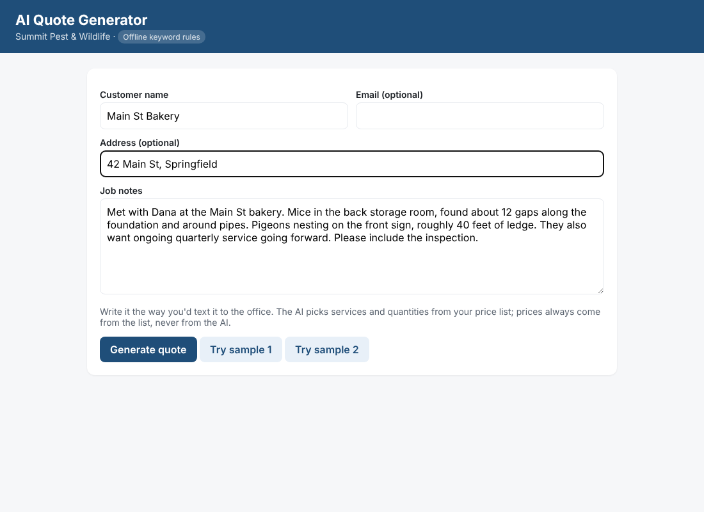
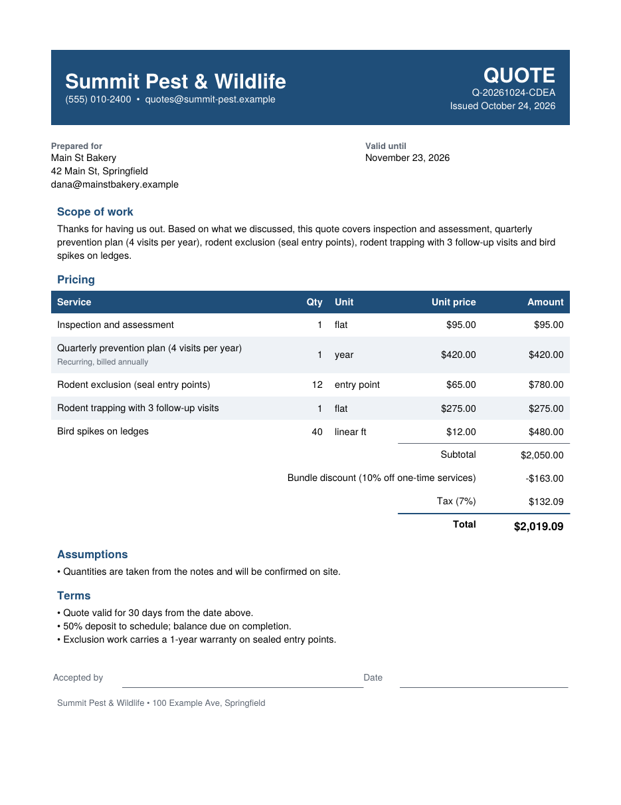

# AI Quote Generator

Paste notes from a site visit or phone call and get a **priced, branded PDF quote** in seconds.

Built for small service businesses (pest control, HVAC, cleaning, landscaping, trades) where quotes are written by hand and go out days late. Faster quotes win more jobs.





## How it works

1. **The AI reads the notes.** "Mice in the storage room, about 12 gaps along the foundation, pigeons on 40 feet of ledge" becomes rodent exclusion × 12 entry points and bird spikes × 40 linear feet.
2. **Prices come from your price list, never from the AI.** Services, unit prices, tax, minimum job charge and bundle discounts live in one file, [`data/company.yaml`](data/company.yaml). The AI can only choose services that exist in that file. Every dollar is calculated in plain Python.
3. **You get a PDF ready to send**, with your branding, scope of work, line items, assumptions, terms and a signature line. It also lists questions to confirm with the customer when the notes leave something out, such as a missing quantity.

It runs with **Claude** (Anthropic API) when an API key is set. Without a key it uses keyword rules, so the demo works offline.

## Run it

```bash
pip install -r requirements.txt
uvicorn app.main:app --reload
```

Open http://localhost:8000, click **Try sample 1**, then **Generate quote**, then **Download PDF**.

To use Claude, copy `.env.example` to `.env` and add your key (`ANTHROPIC_API_KEY=sk-ant-...`), then restart the app. The header badge changes from "Offline keyword rules" to "Claude AI".

With Docker: `docker build -t quote-generator . && docker run -p 8000:8000 -e ANTHROPIC_API_KEY quote-generator`

Tests: `pytest -q`

## Use it for a different business

Edit `data/company.yaml`: company name, colors, contact details, tax rate, minimum charge, discount rules, terms, and services. For each service, set:

| Field | Example | Purpose |
|---|---|---|
| `code` | `RX` | Short ID |
| `name` | `Rodent exclusion (seal entry points)` | Shown on the quote |
| `unit` / `price` | `entry point` / `65.00` | Price per unit (`flat` = one price) |
| `keywords` | `[mice, rats, gaps]` | Words that suggest this service (offline mode) |
| `qty_words` | `[entry point, gap]` | Units that follow a number, as in "12 gaps" (offline mode) |
| `recurring` | `true` | Plans billed annually; excluded from one-time discounts |

To keep several businesses' price lists side by side, point `CATALOG_PATH` at a different file.

## API

| Method | Path | Purpose |
|---|---|---|
| POST | `/api/quotes` | `{"customer": {"name": "..."}, "notes": "..."}` → priced quote (JSON) plus `pdf_url` |
| GET | `/api/quotes/{number}` | Fetch a quote |
| GET | `/quotes/{number}.pdf` | The PDF |
| GET | `/catalog` | The price list in use |

The API makes it easy to connect a CRM, a form tool, or a Zapier, Make or n8n workflow. For example, a new form submission can trigger a quote that's emailed automatically.

## Project layout

```
app/parser.py    notes → services and quantities (Claude tool call, or keyword rules)
app/pricing.py   deterministic pricing: discounts, minimums, tax
app/pdf.py       branded PDF (ReportLab)
app/main.py      web form and REST API (FastAPI)
data/            company profile and price list
```

## Production notes

Quotes are kept in memory, so they disappear on restart. For real use, store them in PostgreSQL, add login, and send PDFs by email or through the CRM. The sample company and prices are fictional.
